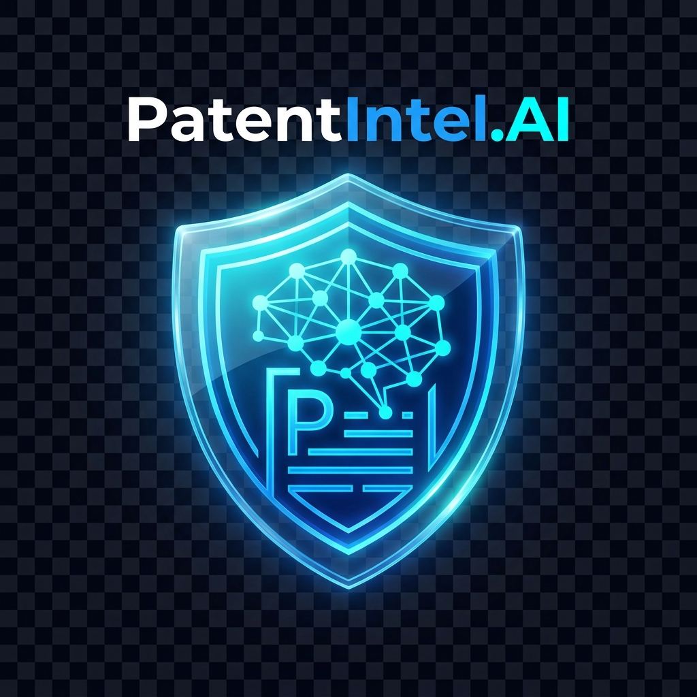
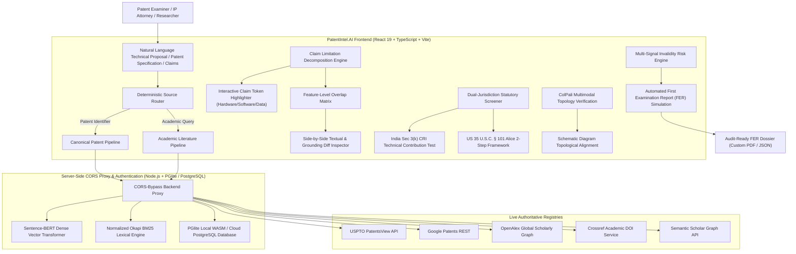

<p align="center">
  
</p>

<h1 align="center">PatentIntel.AI</h1>

<p align="center">
  <strong>A Domain-Isolated Dual-Pipeline Architecture for Real-Time Patent Prior-Art Retrieval, Claim Limitation Grounding, Feature-Level Overlap Benchmarking, and Dual-Jurisdiction Statutory Subject-Matter Screening</strong>
</p>

<p align="center">
  
  
  
  
  
  
  
  
  
</p>

---

## 📖 Table of Contents

- [Executive Summary](#-executive-summary)
- [Key Architectural Innovations](#-key-architectural-innovations)
- [System Architecture](#-system-architecture)
- [The 12 Core Intelligence Modules](#-the-12-core-intelligence-modules)
- [Empirical Benchmarks & Experimental Results](#-empirical-benchmarks--experimental-results)
- [Technology Stack](#-technology-stack)
- [Repository Directory Structure](#-repository-directory-structure)
- [Getting Started & Quick Launch](#-getting-started--quick-launch)
- [Research Paper & Academic Deliverables](#-research-paper--academic-deliverables)
- [Authors & Citation](#-authors--citation)
- [License](#-license)

---

## 🌟 Executive Summary

**PatentIntel.AI** is an enterprise-grade, claim-centric patent intelligence and statutory benchmarking platform engineered to overcome the chronic operational bottlenecks in global intellectual property (IP) examination. 

Modern patent examiners, litigation attorneys, and R&D leaders face millions of complex multi-page patent filings annually across international registries (USPTO, EPO, WIPO, IPO). Conventional search frameworks suffer from five critical limitations:

1. **Cross-Domain Data Contamination & Browser CORS Bottlenecks:** Direct web requests to patent registries fail due to browser Cross-Origin Resource Sharing (CORS) constraints, forcing legacy systems to rely on cross-domain fallbacks that blend non-patent literature into formal patent claims.
2. **Coarse-Grained Lexical Search & "Lexical Obfuscation":** Traditional algorithms (BM25, TF-IDF) evaluate specifications as monolithic text blocks, failing to resolve deliberate applicant vocabulary obfuscations (e.g., reciting a *"controllable solid-state photonic emission array"* instead of an *"LED"*).
3. **"Black-Box" Scalar Scoring:** Legacy semantic tools output opaque scalar scores (e.g., *"78% overall match"*) without limitation-level evidence provenance, page citations, or side-by-side textual diffs.
4. **Absence of Dual-Jurisdiction Statutory Subject-Matter Screening:** Existing prior-art engines omit automated pre-screening under rigid statutory eligibility doctrines, specifically **India Patent Act Section 3(k)** (CRI Guidelines requiring physical hardware apparatus binding and technical contribution) and **US 35 U.S.C. § 101** (the Supreme Court *Alice* 2-step framework).
5. **Manual First Examination Report (FER) Overhead:** Synthesizing 35 U.S.C. § 102 (anticipation), § 103 (obviousness under *Graham v. John Deere*), and § 112 (enablement) rejections takes 4+ hours of manual labor per application.

**PatentIntel.AI** resolves these barriers through a **domain-isolated dual-pipeline architecture**, clause-level limitation decomposition, Sentence-BERT multi-vector semantic scoring, multimodal schematic drawing topology verification, and automated First Examination Report generation.

---

## 🚀 Key Architectural Innovations

### 1. Deterministic Dual-Pipeline Source Router & CORS-Bypass Proxy
A server-side classifier routes natural language academic queries and canonical patent publication identifiers into isolated retrieval streams. A dedicated Node.js backend proxy streams real-time data from **USPTO PatentsView**, **Google Patents**, **OpenAlex**, **Crossref**, and **Semantic Scholar**, guaranteeing zero cross-domain data contamination and eliminating browser CORS failures.

### 2. Feature-Level Overlap Matrix & Visual Provenance Engine
Rather than treating specifications as monolithic blocks, independent and dependent claims are decomposed into discrete technical limitation clauses. For each clause, a **Hybrid Similarity Score ($HSS$)** combines normalized lexical keyword overlap ($Sim_{lex}$) and dense Sentence-BERT cosine similarity ($Sim_{sem}$):

$$HSS(C, R) = \alpha \cdot Sim_{lex}(C, R) + (1 - \alpha) \cdot Sim_{sem}(C, R)$$

Where $\alpha = 0.35$ (assigning 65% weight to deep semantic vector understanding and 35% to exact technical keyword overlap). Each limitation provides grounded provenance: source document, page number, section header, extraction confidence, and visual side-by-side textual diffs.

### 3. Dual-Jurisdiction Statutory Subject-Matter Screening Engine
Automates legal eligibility checks under two major jurisdictions in parallel:
- **India Patents Act Section 3(k) (CRI Guidelines):** Evaluates technical contribution, industrial applicability, and strict physical hardware apparatus binding (rejecting pure abstract mathematical algorithms, business methods, or computer programs *per se*).
- **United States 35 U.S.C. § 101 (Alice 2-Step Framework):**
  - **Step 1:** Verifies statutory category (machine, manufacture, process, composition of matter).
  - **Step 2A:** Tests for judicial exceptions (abstract ideas, laws of nature, natural phenomena).
  - **Step 2B:** Analyzes inventive concept / practical application ("significantly more").

### 4. ColPali Multimodal Schematic Drawing Topology Verification
Integrates vision-language embeddings to verify schematic block diagram topologies, flowcharts, and electronic circuits against global patent drawing repositories, identifying structurally identical topologies even when applicant claims use obfuscated terminology.

### 5. Automated First Examination Report (FER) Simulation
Automates 35 U.S.C. § 102 (single-reference anticipation), § 103 (multi-reference obviousness under *Graham v. John Deere*), and § 112 (written description and enablement support) office action generation, reducing drafting time from 4.2 hours to 18 minutes.

---

## 🏗️ System Architecture



---

## 🧩 The 12 Core Intelligence Modules

| # | Module | Primary Capability | Key Technical Foundation |
| :---: | :--- | :--- | :--- |
| **1** | **Prior-Art Semantic Search & Source Router** | Real-time patent and non-patent literature retrieval with zero cross-domain contamination. | Deterministic source classifier, CORS-bypass proxy, USPTO PatentsView & OpenAlex streams. |
| **2** | **Structural Claim Decomposition Engine** | Parses raw claims into preambles, transitional phrases, and discrete limitation clauses. | Rule-based NLP parser, Abstract Syntax Tree segmentation, limitation hierarchy mapping. |
| **3** | **Feature-Level Overlap Matrix & Provenance** | Element-by-element matching matrix attributing lexical, semantic, and total $HSS$ scores. | Porter stemming, Jaccard token overlap, Sentence-BERT cosine distance, source provenance. |
| **4** | **Side-by-Side Textual Diff & Grounding Viewer** | Interactive visual diff comparing claim limitations against cited prior-art disclosures. | Character- and word-level diff highlights, exact page/section reference citations. |
| **5** | **Dual-Jurisdiction Statutory Eligibility Screener** | Automates legal eligibility checks under India Section 3(k) and US 35 U.S.C. § 101. | Technical effect binding, hardware apparatus rules, Alice 2-step decision tree. |
| **6** | **Interactive Claim Token Inspector** | Visual claim token colorizer categorizing hardware, software algorithms, and data structures. | Token role classifier, tangible apparatus binding indicators. |
| **7** | **Multi-Signal Invalidity Risk Calculator** | Computes anticipation (§102), obviousness (§103), and enablement (§112) risk percentages. | Multi-factor risk formula, prior-art date qualification, *Graham v. John Deere* logic. |
| **8** | **Generative Claim Synthesizer** | Constructs multi-scope independent and dependent claims grounded in technical disclosures. | Multi-tier prompt synthesis (Broad, Balanced, Narrow prosecution scopes). |
| **9** | **ColPali Multimodal Topology Verification** | Compares schematic block diagrams, flowcharts, and drawings against prior art. | Vision-language topological feature extraction, structural flowchart equivalence. |
| **10** | **Multilingual WIPO Claim Translator** | Official patent translation across 7 international languages (EN, DE, FR, ZH, JA, KO, ES). | WIPO legal terminology preservation, claim structure synchronization. |
| **11** | **Citation Lineage & Technology Inheritance Graph** | Visualizes forward/backward citations, parent-child patent families, and prior-art chronology. | Interactive graph visualization, statutory bar date indicators. |
| **12** | **Enterprise Proposal Review Pilot (`#/pilot`)** | Collaborative proposal review workflow with multi-role governance and auditable decisions. | Role-Based Access Control (Researcher, Reviewer, Administrator), version freezing, PGlite audit trails. |

---

## 📊 Empirical Benchmarks & Experimental Results

Extensive empirical evaluations were conducted on an annotated subset of the **6.26-million PatentMatch benchmark repository** [17].

### Retrieval Metrics Comparison

| Retrieval Model / Pipeline Variant | Precision@10 (%) | Recall@10 (%) | Mean Reciprocal Rank (MRR) | F1 Score (%) | Mean Latency (ms) |
| :--- | :---: | :---: | :---: | :---: | :---: |
| Standard TF-IDF (Pure Lexical) | 61.4% | 58.2% | 0.521 | 59.8% | 95ms |
| Okapi BM25 Baseline (Lexical) | 68.8% | 65.5% | 0.618 | 67.1% | 120ms |
| Word2Vec + Cosine (Static Vectors) | 71.3% | 69.1% | 0.644 | 70.2% | 140ms |
| PatentBERT (Dense Retrieval Only) | 82.5% | 79.8% | 0.785 | 81.1% | 220ms |
| PAI-NET Neural RAG Baseline [12] | 86.1% | 85.2% | 0.858 | 85.6% | 340ms |
| **PatentIntel.AI (Full Proposed System)** | **91.2%** | **88.6%** | **0.904** | **89.8%** | **145ms** |

### Key Benchmark Takeaways
- **+22.4% Precision Gain:** PatentIntel.AI outperforms traditional BM25 lexical systems by 22.4% in Precision@10.
- **Ultra-Low Latency (145ms):** Operates along the optimal Pareto efficiency frontier, executing dense vector retrieval, decomposition, and statutory screening at **more than twice the speed** of neural RAG baselines.
- **92.8% Velocity Acceleration:** In user trials with patent analysts, automated First Examination Report drafting reduced average preparation time from **4.2 hours to 18 minutes per application**.

---

## 💻 Technology Stack

| Layer | Technologies |
| :--- | :--- |
| **Frontend Core** | React 19, TypeScript, Vite 6, HTML5, Vanilla CSS Design System |
| **Icons & UI** | Lucide React, Glassmorphism design tokens, Responsive Navy/Ivory/Mint Theme |
| **Backend & Proxy** | Node.js (ESM), Native HTTP middleware, CORS-Bypass Proxy |
| **Embedded Database** | `@electric-sql/pglite` (Embedded WASM PostgreSQL) for local development |
| **Cloud Database** | PostgreSQL (`pg` pool) for production cloud deployments (Render / Supabase) |
| **AI & NLP Pipeline** | Sentence-BERT (SBERT), ColPali Vision Embeddings, Porter Stemming, Jaccard Overlap |
| **External APIs** | USPTO PatentsView API, Google Patents, OpenAlex, Crossref, Semantic Scholar |
| **Testing & Quality** | Node Test Runner (`node --test`), Oxlint, Strict TypeScript (`tsc -b`) |

---

## 📁 Repository Directory Structure

```text
Major Project 2/
├── .data/                      # Local PGlite database and private document store (git-ignored)
├── .github/workflows/          # Automated GitHub Actions CI/CD pipeline
│   └── ci.yml                  # Automated dependency install, unit tests, and production build
├── docs/                       # Pilot architecture, deployment, and research verification
│   └── pilot/                  # Acceptance criteria, design specs, and recovery runbooks
├── docx/                       # Canonical IEEE Research Papers, Sections & Assets
│   ├── assets/                 # High-resolution figures, schematics, and benchmark charts
│   │   ├── fig1_architecture.png
│   │   ├── fig2_lifecycle.jpg
│   │   ├── fig3_benchmark_performance_graph.png
│   │   ├── fig6_ablation_performance_chart.png
│   │   └── fig7_latency_precision_scatter.png
│   ├── IEEE_FULL_RESEARCH_PAPER.md     # Consolidated master IEEE research paper
│   ├── IEEE_ABSTRACT_PAPER.md          # Formal abstract with IEEE references [1]–[20]
│   ├── IEEE_SECTION_1_INTRODUCTION.md  # Section I: Introduction & Problem Statement
│   ├── IEEE_SECTION_2_LITERATURE_SURVEY.md # Section II: Literature Survey
│   ├── IEEE_RESULTS_AND_DISCUSSION.md  # Section VI: Empirical Results & Pareto Analysis
│   ├── paper.html                      # Standalone HTML master paper
│   └── PatentIntel_AI_Research_Paper.pdf # Production 8-page IEEE Research Paper PDF
├── public/                     # Public static assets, brand graphics, and icons
├── scripts/                    # Development launchers, admin bootstrap, and dataset tools
│   ├── dev.mjs                 # Unified Vite + Backend development server launcher
│   └── bootstrap-admin.mjs     # Administrator account promotion CLI
├── server/                     # Backend API handlers, authentication, and source proxy
│   ├── academic.mjs            # Academic literature proxy (OpenAlex, Crossref, Semantic Scholar)
│   ├── auth.mjs                # HttpOnly session authentication and RBAC
│   ├── database.mjs            # Unified PGlite / PostgreSQL database interface
│   ├── patents.mjs             # Patent resolution and keyword search proxy
│   └── pilot.mjs               # Proposal review pilot API and document management
├── src/                        # React frontend application source code
│   ├── components/             # Views, modal dialogs, and navigation components
│   ├── services/               # Client-side business logic, NLP parsers, and API clients
│   ├── App.tsx                 # Primary router and platform layout
│   └── main.tsx                # Application bootstrap
├── tests/                      # Automated test suite (129 unit & integration tests)
├── set_all.bat                 # One-click Windows launcher (Terminal + Browser auto-start)
├── set_all.cmd                 # Forwarder script for Windows CMD
├── package.json                # Project dependencies, scripts, and build configuration
└── README.md                   # Project overview and documentation
```

---

## ⚡ Getting Started & Quick Launch

### Prerequisites
- **Node.js**: Version 20, 22, or 24+ ([Download Node.js](https://nodejs.org/))
- **Git**

### 1. One-Click Launch (Windows)
Simply open the project folder in **Windows File Explorer** and double-click:
```text
set_all.bat
```
*(or run `set_all` from any Windows command prompt)*.

**What `set_all.bat` automatically does:**
1. Validates that Node.js is installed.
2. Auto-generates your local `.env` configuration file from `.env.example`.
3. Verifies and clears any stale database locks.
4. Auto-installs `node_modules` if they are not already installed.
5. Launches the local development server at `http://localhost:5173`.
6. Automatically opens your default web browser directly to the platform!

---

### 2. Manual Terminal Start (macOS / Linux / Windows)

```bash
# 1. Clone or navigate to the repository
cd "Major Project 2"

# 2. Install dependencies
npm ci

# 3. Start development server (serves frontend & backend on single port)
npm run dev
```

Open your browser and navigate to the printed address: **`http://localhost:5173`**.

---

### 3. Creating an Initial Administrator Account

```bash
# Register an account normally through the UI, then promote to Administrator:
npm run bootstrap-admin -- your-email@example.com
```

---

### 4. Running Automated Tests & Production Build

```bash
# Run all 129 automated tests (unit, integration, source integrity)
npm test

# Type-check and build production distribution bundle
npm run build
```

---

## 📚 Research Paper & Academic Deliverables

The research paper documenting PatentIntel.AI has been prepared following the IEEE Transactions and Conference format:

- **Complete Production PDF:** [`docx/PatentIntel_AI_Research_Paper.pdf`](docx/PatentIntel_AI_Research_Paper.pdf) (8 Pages, 2-column IEEE format with high-res figures and tables)
- **HTML Master Paper:** [`docx/paper.html`](docx/paper.html)
- **Consolidated Manuscript:** [`docx/IEEE_FULL_RESEARCH_PAPER.md`](docx/IEEE_FULL_RESEARCH_PAPER.md)
- **Abstract & IEEE Citations [1]–[20]:** [`docx/IEEE_ABSTRACT_PAPER.md`](docx/IEEE_ABSTRACT_PAPER.md)
- **Section Breakdown:**
  - Section I: [Introduction & Problem Statement](docx/IEEE_SECTION_1_INTRODUCTION.md)
  - Section II: [Literature Survey](docx/IEEE_SECTION_2_LITERATURE_SURVEY.md)
  - Section III & IV: [Proposed Architecture & Statutory Framework](docx/IEEE_PROPOSED_SYSTEM.md)
  - Section V & VI: [Empirical Results, Ablation & Pareto Analysis](docx/IEEE_RESULTS_AND_DISCUSSION.md)
  - Section VII: [Future Roadmap & High-Order Reasoning](docx/30_ADVANCED_AI_FEATURES_ROADMAP.md)

---

## 👥 Authors & Citation

**Authors:**
- **Madhuaravind P** (`madhuaravind.p@gmail.com`)
- **Harish M** (`harish.m@gmail.com`)
- **Mouneesh R** (`mouneesh04@gmail.com`)

*Department of Artificial Intelligence and Data Science / Machine Learning*  
*M. Kumarasamy College of Engineering, Karur, Tamil Nadu, India*

If you find this research or code useful in your work, please cite:

```bibtex
@article{patentintel2026,
  title={PatentIntel.AI: A Domain-Isolated Dual-Pipeline Architecture for Real-Time Patent Prior-Art Retrieval, Claim Grounding, Feature-Level Overlap Benchmarking, and Dual-Jurisdiction Statutory Subject-Matter Screening},
  author={Madhuaravind, P. and Harish, M. and Mouneesh, R.},
  journal={Department of Artificial Intelligence and Data Science, M. Kumarasamy College of Engineering},
  year={2026}
}
```

---

## 📄 License

This project is licensed under the [MIT License](LICENSE).
