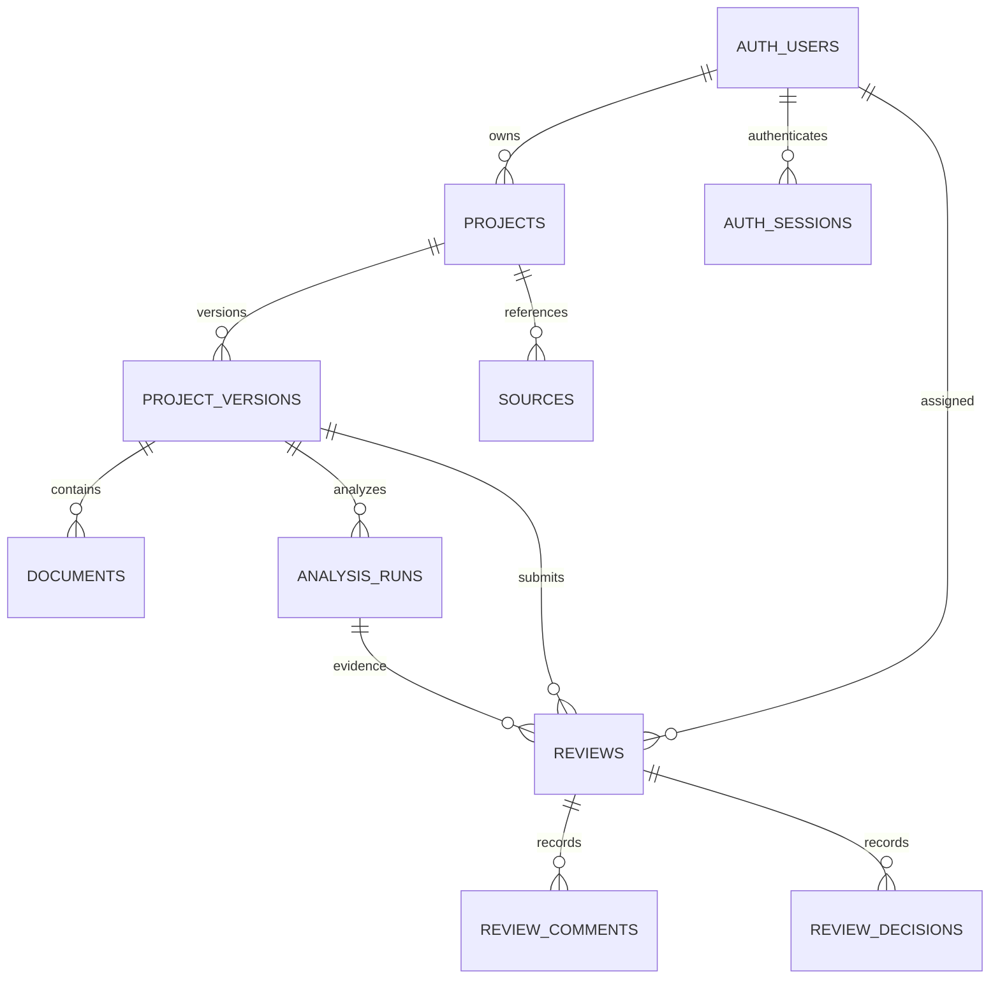
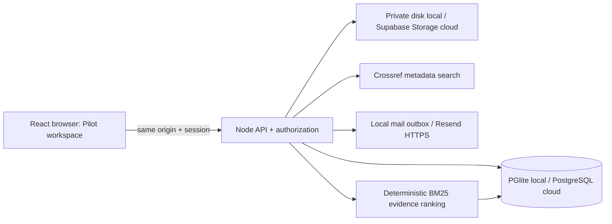

# Pilot requirements and design — 2 October 2026

Status: local implementation and verification in progress; hosted acceptance is NOT certified. This document supersedes the legacy research drafts as a statement of delivered scope.

## Objective and requirements traceability

The release supports researcher → proposal → evidence → assigned reviewer → revision → decision → export. English text and text PDFs are supported; OCR, model training, semantic search, legal screening, vision and claim generation are deferred.

| ID | Requirement / screen | Records / interface | Acceptance / status |
|---|---|---|---|
| A1 | Register, login, verify, recover, logout | auth_users, sessions, tokens; /api/auth | auth and verification HTTP tests pass; hosted delivery pending |
| A2 | Researcher / Reviewer / Administrator | server session roles, invitations | cross-user and self-approval rejection tests pass |
| P1 | Dashboard / proposal editor | projects, immutable project_versions; /api/projects | ownership, version conflict and restart tests pass |
| D1 | TXT / PDF import, 20 MB / 100 pages | documents, private object storage; /api/documents | empty, scan, corrupt, duplicate, oversize tests pass |
| E1 | Editable proposal features | version.features | source-derived suggestions; user confirmation required |
| E2 | Sources and evidence ledger | sources, analysis_runs; /api/sources, /api/analysis-runs | source separation, exact excerpts, zero-match and BM25 tests pass |
| R1 | Assigned review / comments / decisions | reviews, review_comments, review_decisions; /api/reviews | automated and browser revision/decision checks pass |
| X1 | Version-specific PDF/JSON report | immutable version/run + version-bound review | component/API and downloaded JSON checks pass; saved PDF inspection pending |
| O1 | Cloud durability | PostgreSQL + private object storage | hosted restart, backup/restore, rollback pending credentials |

## Role permissions

| Action | Researcher | Reviewer | Administrator |
|---|---|---|---|
| Create/edit/archive own proposal | Yes | Yes | Yes |
| Read another proposal | No | Only assigned submitted versions | Yes |
| Read unsubmitted revisions/source library | Owner only | Owner only | Yes |
| Comment/decide assigned review | No | Yes, never own work | Yes, only when assigned, never own work |
| Invite users/assign reviewers | No | No | Yes |
| Export | Own versions | Assigned submitted versions | Yes |

Public registration always creates Researcher. No UI role switch. Bootstrap an existing account with the operator command. Pilot is one research team; organizations are profile labels, not a tenancy boundary.

## API and state contracts

All /api routes except account registration/login/recovery/verification require a live HttpOnly session. Mutations require the configured Origin. Project operations use server-derived identity. Foreign identifiers return 404. Invalid state transitions and stale revisions return 409.

GET/POST /api/projects; GET/PATCH /api/projects/:id; POST /api/projects/:id/versions; POST /api/documents; GET /api/documents/:id; GET/POST /api/sources; POST /api/sources/search; POST /api/analysis-runs; GET /api/reviews; POST /api/reviews; POST /api/reviews/:id/comments; POST /api/reviews/:id/decision; GET /api/reports/:versionId; POST /api/admin/invitations.

Each save creates an immutable version with title, proposal text and approved feature list. A review references a version and completed analysis run. Its state is SUBMITTED / RESUBMITTED → UNDER_REVIEW → NEEDS_REVISION / APPROVED_FOR_DRAFTING / REJECTED. Resubmission creates a new review for a new version; previous comments/decisions remain immutable. Editing never mutates the submitted snapshot. New versions have no current analysis.

## ER diagram

## Architecture and data flow

The pilot uses no provider credentials in browser bundles. Legacy generative providers are disabled, browser credential entry is removed, and academic retrieval now shares the server boundary. Live search sends only user-entered queries to Crossref; proposal text is not automatically sent to an LLM. AI is disabled. A source is user-supplied or provider-retrieved; a manually entered citation is not called independently verified. Metadata-only sources cannot substantiate full-text claims.

## Screen design

Navy navigation, ivory workspace, mint actions; shared labels, focus outlines, status/error panels and responsive cards. Sidebar: Dashboard, Proposals, Sources & Evidence, Reviews, Reports, Settings. Selected project persists in the URL, not as authorization. Empty dashboard offers Create proposal. Proposal detail has editable draft, immutable version selection/diff, feature editor, import, evidence ledger and review timeline. Researchers see next steps; reviewers see assigned work. Administrators see account invitations and assignment. The report print view omits navigation/actions and includes method/limitations.

## Evidence method

BM25 uses k1=1.2, b=0.75 and positive smoothed IDF log(1+(N-df+0.5)/(df+0.5)). Tokenization is Unicode letters/numbers, lowercased; query terms deduplicated. Rank exact stored passages, use deterministic ties, return zero matches when no tokens overlap. Scores are uncalibrated retrieval relevance, never novelty/eligibility probabilities. Persist corpus excerpts, source labels and parameters with every run. Interrupted RUNNING records become INTERRUPTED at startup and can be rerun. Automatic legal conclusions, manufactured improvements and simulation scores are excluded.

## Delivery and release gates

Keep existing account records. Legacy browser projects require explicit import and are treated as unverified user input, never seeded automatically. New migrations are transactional and idempotent. Documents use private storage; application disk is not durable on Render. See DEPLOYMENT.md for runbooks. No hosted release is complete until every acceptance row has evidence from the deployed application.

## Retained platform scope

At the user's request, the original 12-module platform remains the default entry, with a sidebar link to the persistent pilot. Pilot routes use #/pilot and preserve project/version identifiers. Legacy records remain browser-local and are not covered by pilot ownership guarantees. See ACCEPTANCE.md for automated, browser and outstanding checks; navigation smoke coverage is not complete feature certification.

## Compatibility acceptance matrix — 3 October 2026

| Requirement | Screen | Data/API | Acceptance evidence | Status |
|---|---|---|---|---|
| Server-side academic retrieval | Literature / prior-art search | POST /api/academic/search, /authors, /author-works | academic-server tests; live built-app browser search | Locally verified; hosted pending |
| Explicit provider failures and partial results | Literature search | providerStatuses and warnings | malformed/empty/outage/partial-author tests; live partial outage | Locally verified |
| No browser provider secrets | Platform settings / startup | Legacy settings sanitation; no frontend provider calls in LLM client | module-audit credential tests; settings browser check | Locally verified; AI disabled |
| Retain documentation and research assets | Repository | SHA-256 cleanup inventory | CLEANUP.md | Preserved |
| Saved PDF matches selected version | Pilot report | Existing version-bound report snapshot | PDF inspection still unavailable | Pending |

Academic request bodies are JSON: search accepts filters, authors accepts query, author-works accepts author plus optional filters. Existing academic result types are retained; responses include per-provider status and retrieval timestamps. Calls require the existing HttpOnly session; no replacement auth or database migration is introduced here. Research experiments are retained outside the application import graph. PatentsView keyword search remains a separate compatibility gate.

## Shared UI checkpoint — 6 October 2026

Both workspaces and authentication consume a single light theme: ivory surfaces, navy foreground/primary controls and mint accents; Inter body text and Outfit headings. Existing dark preferences no longer control the page, and the theme switch is removed. Legacy semantic chart/status colours remain distinct but are muted for light surfaces. Navigation, focus, disabled controls and responsive cards share the same treatment. Route/API/data contracts are unchanged.

| Requirement | Screen / interface | Observed acceptance | Status |
|---|---|---|---|
| Consistent theme | Authentication, 12 legacy routes, six pilot routes; shared CSS tokens | Desktop/tablet/mobile route checks and representative screenshots, 5 October | Implemented; complete populated-state visual audit pending |
| Private document upload | Proposal Documents / authenticated documents API | In-app browser TXT upload and excerpt; owner 200, other researcher 404, signed-out 401, 6 October | Locally verified for TXT |
| Version export and persistence | Report / version-bound JSON | Version-2 ID, text and features match; retained after QA restart | JSON locally verified; actual PDF pending |

Preserve both workspaces and all research documents. PR #9 is already merged upstream; publish these UI changes as a follow-up pull request. Do not merge or deploy as part of this checkpoint. Newer unrelated authentication and development-script changes remain separate working-tree work.

## Delivered implementation & deferred capability status — 6 October 2026

Traceability of completed implementations alongside explicit deferred/non-implemented items per institutional design constraints:

| Requirement / Capability | Implemented | Scope & Evidence | Notes / Constraints |
|---|---|---|---|
| **Multi-Role Governance & Session RBAC** | **Yes** | Server sessions bound to `Researcher`, `Reviewer`, and `Administrator` roles (`server/pilot.mjs`, `server/auth.mjs`); verified via HTTP tests. | Public registration defaults to `Researcher`. `Administrator` invites team members; bootstrap script available for operator accounts. |
| **Anti-Collision Self-Approval Prevention** | **Yes** | Gated on server (`r.owner_id === user.id` rejected) and UI (`Self-Approval Prohibited` badge). | Authors/inventors cannot approve their own submissions under any circumstances. |
| **Role Permissions & Feature Matrix** | **Yes** | Interactive `RoleMatrixTable.tsx` deployed to both workspaces (`#/pilot/settings` and `#/settings`). | Clearly delineates allowed vs. restricted actions, highlighting the current user's role. |
| **Workspace Layout & Typography Modernization** | **Yes** | Standardized 16px/15.5px base typography, 330px platform sidebar, 280px pilot sidebar, and scaled typography across the Patent Team Review Queue. | Eliminates text truncation, small fonts, and cramped layouts across all screens. |
| **Verified Saved Report PDF Export** | **Yes** | Headless Chrome 4-page A4 print generation (`scratch/inspected-report.pdf`) verified via `parseDocument` with canonical `EvidenceMatch` schema. | Full alignment between downloaded JSON and printed PDF report. |
| **Server Academic & Patent Proxies** | **Yes** | Authenticated Node handlers for Crossref DOI metadata and PatentsView patent lookup. | Server-side API key containment; client never holds external provider secrets. |
| **Generative AI Claims & Legal Screening** | **No (Deferred)** | Disabled by statutory policy; custom endpoint fields removed from settings. | Zero hallucinated text or artificial novelty probability scores. |
| **Hosted Cloud Deployment** | **No (Deferred)** | Local PGlite and filesystem storage active; hosted release paused. | Requires operator credentials for Render, Supabase, and Resend. |
| **Scanned Document OCR / Computer Vision** | **No (Deferred)** | Plain text and text-layer PDFs supported up to 20MB / 100 pages. | Scanned PDFs require user OCR prior to ingestion. |
| **Live PatentsView Keyword Search** | **No (Deferred)** | Publication number lookup active; keyword search returns HTTP 503 without synthetic fallbacks. | Requires server configuration of `PATENTSVIEW_API_KEY`. |

## Review queue screen implementation & deferred capability matrix — 6 October 2026

Traceability of the Patent Team Review Queue (`#/review-queue`) workspace components, detailing delivered implementation versus deferred/policy-restricted items per institutional pilot constraints:

| Review Workspace Component / Action | Implemented | Technical Scope & Evidence | Design Rationale & Policy Notes |
|---|---|---|---|
| **Two-Pane Synchronized Review Workspace** | **Yes** | Split layout with incoming proposal list (left pane) and reactive detail inspector (right pane); `IdeaNoveltyView.tsx`. | Provides synchronized context between pending proposals and deep technical disclosures without page reload. |
| **Prior-Art Audit Inspection (`Inspect Prior-Art Audit`)** | **Yes** | Direct subview navigation (`audit` tab) displaying claim-level overlap matrix against indexed patent and academic corpus. | Allows examiners to drill down from proposal summary into granular component-by-component citation evidence. |
| **Simulated FER Generation & Export (`Simulate / Export FER`)** | **Yes** | Pre-examination Office Action simulator evaluating 35 U.S.C. §§ 101, 102, 103, and FTO status; downloads formal `.txt` dossier. | Enables structured pre-examination feedback and formal audit trail export for research records. |
| **Formal Decision Workflow & Anti-Collision (`Issue Review Decision`)** | **Yes** | Role-gated modal (`APPROVED_FOR_DRAFTING`, `NEEDS_REVISION`, `REJECTED`) with examiner rationale comments logged permanently in audit dossier. | Strictly enforces anti-collision: authors cannot approve their own submissions; requires Reviewer or Administrator permissions. |
| **Historical Version Audit Trail** | **Yes** | Chronological version snapshot listing (`v1.0`, `v2.0`, etc.) with feature counts and creation timestamps via `dbStore.getInnovationVersions`. | Maintains an immutable audit record across proposal revisions for institutional governance. |
| **Technical Problem & Architecture Specs** | **Yes** | Structured two-column specification isolating the technical deficiency from the proposed solution architecture. | Ensures full technical disclosure and clear demarcation of problem-solution pairs. |
| **Review Thread & Examiner Feedback Dossier** | **Yes** | Append-only ledger recording all examiner comments, revision requests, and formal decision stamps; `dbStore.getReviewComments`. | Prevents comment alteration and maintains tamper-evident audit history across review rounds. |
| **Automated Claim Drafting (`Generate Claim Draft`)** | **No (Deferred)** | Button routes to experimental handoff in prototype mode, but automated generative claim synthesis is deferred in pilot release. | Statutory policy prohibits unvetted AI claim generation to prevent hallucinated scope and invalidity under 35 U.S.C. § 112; claims require human patent attorney drafting. |
| **Automated Legal Novelty/Obviousness Probabilities** | **No (Deferred)** | Displayed heuristic metrics (`84% Novelty`, `28% Obviousness Risk`) are deterministic lexical retrieval signals, not binding legal certainties. | Statutory compliance: pilot software cannot issue binding legal conclusions; uncalibrated BM25 lexical scores are used solely for research guidance. |
| **ColPali Multimodal Schematic Verification** | **No (Deferred)** | Simulated topological figure matching reference in FER report is deferred; no automated drawing computer vision. | Pilot scope strictly supports plain text and text-layer PDFs (up to 20MB / 100 pages); schematic/CAD image verification deferred. |

