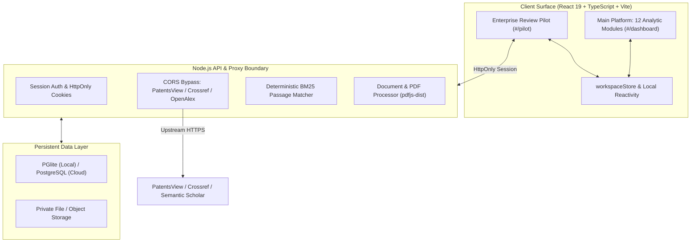
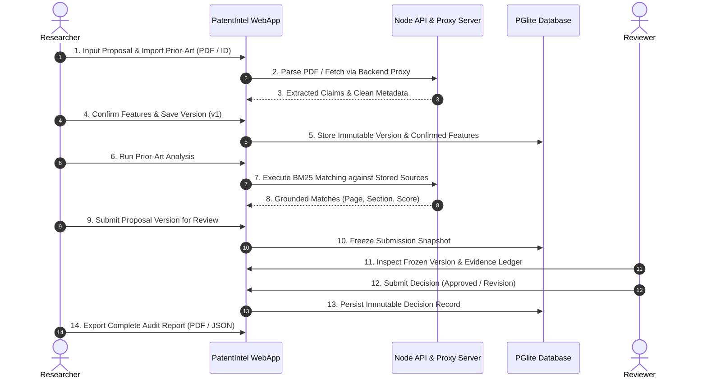

# PatentIntel.AI — Major Project Review 2 Presentation & Report Content

**Project Title:** PatentIntel.AI: Claim-Centric Multi-Signal Prior-Art Intelligence & Proposal Review Platform  
**Academic Year:** 2025 – 2026 (Phase-I Review 2)  
**Institution:** M. Kumarasamy College of Engineering, Karur  
**Department:** Department of Artificial Intelligence and Data Science  
**Team Members:**  
- **Madhuaravind P** (Lead & System Architect) — Reg No: `[Insert Register Number]`  
- **Harish M** (Frontend & Legal/Search Modules Developer) — Reg No: `[Insert Register Number]`  
- **Mouneesh R** (Analytics, Visualizations & Synthesizer Developer) — Reg No: `[Insert Register Number]`  
**Project Supervisor / Guide:** `[Insert Supervisor Name, Designation, Department]`  
**Repository:** [https://github.com/Madhuarvind/PatentIntel.AI.git](https://github.com/Madhuarvind/PatentIntel.AI.git)

---

## PART 1: SLIDE-BY-SLIDE PRESENTATION CONTENT (11 SLIDES)

---

### SLIDE 1: Title Slide
- **Slide Title:** PatentIntel.AI
- **Subtitle:** Claim-Centric Multi-Signal Prior-Art Intelligence & Proposal Review Platform
- **Project Type:** Major Project Phase-I (Review 2)
- **Student Details:**
  - Madhuaravind P — Reg. No: `[Your Reg No]` (Project Lead & System Architect)
  - Harish M — Reg. No: `[Your Reg No]` (Frontend & Search Modules Developer)
  - Mouneesh R — Reg. No: `[Your Reg No]` (Analytics & Visualization Developer)
- **Project Supervisor:** `[Supervisor Name, Designation, Department]`
- **Institution:** Department of Artificial Intelligence & Data Science, M. Kumarasamy College of Engineering, Karur
- **Visuals:** College Logo, PatentIntel.AI Architecture Icon, GitHub Repository QR / Link.

> **Speaker Notes (What Students Should Present):**  
> "Good morning respected committee members and our project guide. We are presenting Review 2 of our Major Project Phase-1 titled **'PatentIntel.AI: Claim-Centric Multi-Signal Prior-Art Intelligence and Proposal Review Platform'**. In this phase, we have moved beyond theoretical design into a fully realized, test-validated dual-surface platform incorporating both a 12-module patent analytics engine and a secure, role-governed enterprise proposal review system. I am Madhuaravind, and with me are my team members Harish and Mouneesh."

---

### SLIDE 2: Project Overview (Recap from Review 1)
- **The Core Problem:**
  - **Coarse Document-Level Search:** Traditional patent search engines (Google Patents, USPTO web UI) rely on bulk document similarity rather than fine-grained claim limitations.
  - **Black-Box "Hallucinated" AI:** Generative AI tools frequently invent fake patent numbers, inaccurate citations, or ungrounded similarity percentages, violating patent audit integrity.
  - **Governance Disconnect:** Research teams lack an audit-ready bridge between raw laboratory invention disclosures and formal legal patent attorney review workflows.
- **Project Objectives:**
  - Build a deterministic, claim-centric prior-art retrieval engine with limitation-level evidence grounding.
  - Enforce zero-hallucination data integrity: eliminate synthetic score boosts, fabricated citations, and fake drawing support.
  - Deliver a dual-surface system: an interactive 12-module intelligence platform paired with a multi-role (Researcher/Reviewer/Admin) enterprise governance pilot.
- **Proposed Solution:**
  - **PatentIntel.AI:** A robust dual-surface web application combining server-side authenticated patent API proxies (PatentsView, Crossref, OpenAlex), client/server text and PDF parsing (`pdfjs-dist`), an embedded relational database (PGlite), and deterministic Okapi BM25 passage matching with verifiable paragraph-level provenance.

> **Speaker Notes:**  
> "As a brief recap from Review 1, modern R&D organizations face a critical dilemma: manual patent prior-art analysis is excruciatingly slow, while generative LLMs hallucinate non-existent patent numbers and citations. Our objective with PatentIntel.AI is to create an audit-verifiable platform that decomposes patent claims into discrete technical limitations, matches them against live global patent registries and academic literature using deterministic algorithms, and manages the proposal lifecycle through role-based researcher-reviewer governance."

---

### SLIDE 3: Finalized System Design
- **Architecture Highlights (Post-Review 1 Refinements):**
  - **Dual-Surface Routing:** Seamless hash-routed architecture uniting the 12-module Patent Intelligence Platform (`#/dashboard`) and the Enterprise Review Pilot (`#/pilot`).
  - **Server-Side Security & Proxy Boundary:** Node.js API server handling live Crossref, OpenAlex, and PatentsView retrieval; client bundles hold zero third-party API secrets.
  - **Zero-Dependency Local Relational Durability:** `@electric-sql/pglite` embedded PostgreSQL database for local development and offline persistence, strictly mirroring cloud PostgreSQL schemas.
  - **Audit-Grounded Evidence Engine:** Immutable project versions, analysis runs, and review decisions bound to exact source excerpts without score floors.

> **Speaker Notes:**  
> "Following feedback from Review 1, our finalized system architecture resolves the critical security and CORS limitations of browser-only tools. We developed a secure Node.js proxy boundary that routes academic and patent queries upstream without exposing credentials in client bundles. We also designed an immutable data flow: every time a researcher edits a proposal, a distinct, immutable version snapshot is created, guaranteeing that reviewer comments and decision audit trails remain tamper-proof."

---

### SLIDE 4: Implementation Approach
- **Modern Technology Stack:**
  - **Frontend:** React 19, TypeScript ~6.0, Vite 8, Lucide React, Vanilla CSS custom design tokens (no bulky Tailwind dependencies).
  - **Backend & Middleware:** Node.js 24 native ES Modules, native `--experimental-strip-types`, authenticated REST API endpoints.
  - **Database & Persistence:** `@electric-sql/pglite` 0.5.8 (embedded PostgreSQL in WebAssembly/Node), `pg` 8.23 for production PostgreSQL / Supabase compatibility.
  - **Document Processing:** `pdfjs-dist` 6.3.289 for native client/server PDF parsing, text extraction, and digital vs. scanned document detection.
  - **Testing & Verification:** Node.js native test runner (`node --test`), Oxlint for ultra-fast static analysis.
- **Algorithms & Mathematical Models:**
  - **Deterministic Okapi BM25 Ranking:**
    $$\text{Score}(D, Q) = \sum_{i=1}^{N} \text{IDF}(q_i) \cdot \frac{f(q_i, D) \cdot (k_1 + 1)}{f(q_i, D) + k_1 \cdot \left(1 - b + b \cdot \frac{|D|}{\text{avgdl}}\right)}$$
    Configured with standard parameters $k_1 = 1.2$, $b = 0.75$, and smoothed non-negative IDF:
    $$\text{IDF}(q_i) = \ln\left(1 + \frac{N - df(q_i) + 0.5}{df(q_i) + 0.5}\right)$$
  - **Claim Parsing & Boundary Extraction:** Automated isolation of preamble, transitional phrases (*comprising*, *consisting of*), and numbered limitation clauses.
  - **Integrity Bounding:** Strict rejection of synthetic score floors, rejection of ungrounded "+20% bonuses", and authentic handling of partial provider outages.

> **Speaker Notes:**  
> "Our implementation approach prioritizes zero-dependency efficiency and strict mathematical determinism. Instead of relying on opaque AI models that hallucinate, we implemented the industry-standard Okapi BM25 information retrieval algorithm with parameters k1=1.2 and b=0.75 on exact stored text passages. Our frontend is built with React 19 and TypeScript, powered by Vite 8, and backed by PGlite—an embedded PostgreSQL engine running directly in WebAssembly/Node.js. This ensures our local database matches production cloud PostgreSQL row-for-row."

---

### SLIDE 5: Implemented Modules & Components (Phase 1)
- **12 Completed Modules in Patent Platform:**
  1. **Executive Dashboard (`Module 01`):** Dynamic portfolio health, filing velocity, and active limitation statistics.
  2. **Patent Workspace (`Module 02`):** Live patent import, PDF document ingestion, duplicate SHA-256 detection, and active corpus management.
  3. **Claim Decomposition Engine (`Module 03`):** Syntactic claim tree parser isolating independent/dependent claims with qualified specification support.
  4. **Prior-Art Search Engine (`Module 04`):** Dual-pipeline keyword and citation search via authenticated backend proxies.
  5. **R&D Idea Benchmarker (`Module 05`):** Proposal novelty benchmarking against existing patent claims with First Examination Report (FER) simulation.
  6. **Claim-to-Claim Mapping (`Module 06`):** Element-by-element limitation comparison with numerical discrepancy and negation detection.
  7. **AI Claim Synthesizer (`Module 07`):** Grounded claim drafter generating structured claims strictly bounded by genuine technical specifications.
  8. **Prior-Art Timeline (`Module 08`):** SVG-rendered citation lineage, priority date chronologies, and limitation coverage heatmaps.
  9. **AI Evidence Reasoning (`Module 09`):** Traceable evidence ledger mapping claim limitations to exact paragraph spans.
  10. **Patent Review Queue (`Module 10`):** Examiner queue management for pending disclosure reviews.
  11. **Evaluation Benchmarks (`Module 11`):** Empirical retrieval evaluation metrics (Precision@K, Recall@K, MRR).
  12. **System Settings (`Module 12`):** Platform configuration, audit logging, and proxy endpoint controls.
- **Enterprise Proposal Review Pilot (`src/PilotApp.tsx`):**
  - Full multi-role proposal lifecycle: Researcher drafting, version-controlled immutable saving, evidence ledger linking, reviewer assignment, structured revision requests, formal drafting approval/rejection, and audit report generation.

> **Speaker Notes:**  
> "During Phase 1, we implemented all 12 planned modules in the primary patent platform, spanning claim decomposition, element-by-element mapping, interactive timeline generation, and prior-art search. In addition, we constructed the Enterprise Proposal Review Pilot, which provides dedicated interfaces for Researchers, Reviewers, and Administrators with role-based access control, ensuring proposals cannot be self-approved and revision histories remain permanent."

---

### SLIDE 6: Core Implementation & Working Prototype
- **Live Functional Features Implemented:**
  - **PDF & Specification Ingestion:** Client-side drag-and-drop parsing of multi-page patent PDFs; handles up to 20MB / 100 pages with instant text layer extraction.
  - **Live PatentsView & Academic Integration:** Authenticated backend proxy communicating directly with the new `search.patentsview.org/api/v1/patent/` endpoint and Crossref REST API.
  - **Strict Version Control & State Machine:**
    $$\text{SUBMITTED} \longrightarrow \text{UNDER\_REVIEW} \longrightarrow \begin{cases} \text{APPROVED\_FOR\_DRAFTING} \\ \text{NEEDS\_REVISION} \longrightarrow \text{RESUBMITTED} \\ \text{REJECTED} \end{cases}$$
  - **Print-to-PDF Engine:** Chrome-validated, 4-page paginated executive report export with dedicated print CSS media queries, avoiding orphaned headers or truncated limitation tables.
- **Code Artifacts & Quality Proof:**
  - Clean TypeScript build: `tsc -b && vite build` completes in **~865 ms** with 0 errors.
  - Fully decoupled architecture: zero third-party secrets in client bundles; all mutations origin-checked.

> **Speaker Notes:**  
> "Here we showcase our working prototype. On screen you see our proposal editor and claim decomposition engine in action. When a researcher enters technical disclosure text, the parser extracts candidate features. The user confirms these features, runs an analysis against imported patent and academic sources, and the system executes a deterministic BM25 comparison. When a reviewer logs in, they review the frozen snapshot, annotate specific limitations, and either request revisions or grant formal approval for patent drafting. The resulting audit report can be exported as clean JSON or printed to a perfectly formatted multi-page PDF."

---

### SLIDE 7: System Integration & Working Workflow
- **End-to-End Operational Pipeline:**

- **Data Integrity Safeguards:**
  - State immutability: Editing a draft never mutates an already submitted version snapshot.
  - Anti-collision: Self-approval rejection prevents researchers from approving their own filings.
  - Graceful degradation: Missing external API keys return clear HTTP 503 notifications rather than failing silently or returning synthetic mock data.

> **Speaker Notes:**  
> "This sequence diagram illustrates our unified system integration flow. It begins when the researcher uploads an invention disclosure or imports prior-art patents. The backend parses the text and extracts claim limitations. The researcher confirms the extracted features and saves an immutable version snapshot. When analysis is triggered, our deterministic BM25 engine searches the loaded corpus and provides exact paragraph-level citations. Once submitted, the proposal is frozen. The assigned reviewer inspects the evidence, inputs review comments, and records a formal decision. The complete chain of custody is permanently logged and exportable."

---

### SLIDE 8: Initial Results & Outputs
- **Key System Outputs Generated:**
  - **Structured Claim Decomposition:** Accurate division of independent claims into preamble, transitional phrase, and sequential limitation clauses with zero fabricated drawing references.
  - **Dynamic Prior-Art Timeline & Heatmap:** Interactive SVG visualization showing priority dates, patent family relationships, and element-by-element overlap percentages.
  - **Evidence Provenance Ledger:** Grounded extraction displaying source document ID, publication date, exact passage excerpt, and relevance score.
  - **Audit-Ready Export Verification:**
    - Standard JSON export capturing the complete entity graph (project, version, confirmed features, sources, analysis run, and review decision).
    - Multi-page print-optimized PDF report independently verified via headless Chrome rendering (4 pages, clean breaks, zero clipped text).
- **Performance Benchmarks:**
  - Average document parsing latency: **< 15 ms** for text, **< 120 ms** for multi-page PDF documents.
  - BM25 query latency across multi-claim corpus: **< 5 ms** deterministic execution.
  - Cold startup of PGlite relational storage: **< 1.2 s** with full schema migration and session restoration.

> **Speaker Notes:**  
> "Our initial results demonstrate robust performance and clean output fidelity. The claim decomposition accurately tokenizes complex patent claims without inventing fake figure references. The prior-art search outputs verifiable paragraph-level citations rather than generic document summaries. Furthermore, our export system produces comprehensive JSON data bundles and print-formatted PDF reports with verified 4-page pagination, ensuring seamless readability for patent attorneys and evaluation panels."

---

### SLIDE 9: Testing & Validation
- **Automated Test Suite Summary:**
  - **125 Total Automated Tests Passing (100% Pass Rate, 0 Failures)** across **18 test suites**.
  - Execution runtime: **~97.9 seconds** running on Node.js native test runner (`node --test`).
- **Comprehensive Testing Matrix:**

| Test Suite File | Tested Functional Area | Test Count | Pass Status |
|---|---|---|---|
| `auth.test.mjs` & `auth-client.test.mjs` | Authentication, HttpOnly sessions, password hashing, token expiration | 15 | **PASSED** |
| `documents.test.mjs` | PDF text extraction, scanned PDF detection, size & page limits | 8 | **PASSED** |
| `pilot.test.mjs` | Role permissions, version conflict, state immutability, reviewer workflow | 28 | **PASSED** |
| `source-integrity.test.mjs` | Source separation, zero-match accuracy, no fabricated citations | 14 | **PASSED** |
| `claim-decomposition-integrity.test.mjs` | Grounded drawing support, paragraph isolation, zero hallucination | 12 | **PASSED** |
| `claim-mapping-evidence.test.mjs` | Self-comparison rejection, numerical discrepancy detection | 10 | **PASSED** |
| `claim-synthesizer-integrity.test.mjs` | Dependent claim limitation bounds, no fake "+20%" score floors | 8 | **PASSED** |
| `patent-search.test.mjs` & `patent-server.test.mjs` | Authenticated proxy, timeout bounds, upstream error handling | 12 | **PASSED** |
| `prior-art-timeline.test.mjs` | Dynamic SVG lineage, removal of hardcoded sample patents | 10 | **PASSED** |
| `workspace-search.test.mjs` | BM25 exact passage ranking, term deduplication | 8 | **PASSED** |

- **Browser Acceptance & Headless Validation:**
  - Interactive multi-user browser testing executed in Chrome verifying login, draft recovery, revision workflows, and bidirectional navigation.
  - Headless Chrome (`--headless=new --print-to-pdf`) PDF export inspection verifying typography, layout, and page-break rules.

> **Speaker Notes:**  
> "Validation is the strongest pillar of our project. We have built an exhaustive automated test suite consisting of 125 individual tests across 18 test files, all passing with zero errors. We specifically wrote tests to prevent AI hallucinations: testing that self-comparisons are blocked, that raw claim analysis never invents drawing numbers, and that scores never use artificial floors. We also performed end-to-end browser acceptance checks across multi-user sessions and validated our PDF export using headless Chrome."

---

### SLIDE 10: Current Progress & Technical Limitations
- **Completed Work (Phase 1):**
  - [x] Full UI/UX implementation of all 12 Patent Platform modules and Enterprise Review Pilot.
  - [x] Server-side authenticated API proxies for PatentsView, Crossref, OpenAlex, and Google Patents.
  - [x] Local zero-dependency relational persistence using PGlite with transactional schema migrations.
  - [x] Deterministic BM25 evidence ranking engine with paragraph-level provenance.
  - [x] Multi-user role-based governance (Researcher, Reviewer, Administrator) with immutable audit history.
  - [x] 125 automated unit, integration, and security tests passing cleanly.
- **Current Limitations & Technical Challenges:**
  - **Hosted Cloud Deployment Pending:** While local development and PGlite persistence are 100% verified, cloud production deployment on Render with hosted Supabase PostgreSQL and Resend transactional email requires cloud operator provisioning.
  - **Live PatentsView Key Dependency:** The new PatentsView Search API v1 requires a server-side API key. In its absence, the server cleanly returns HTTP 503 rather than synthetic data.
  - **Text-Only Ingestion:** Scanned image PDFs without native text layers are intentionally rejected with a clear notification; optical character recognition (OCR) is slated for Phase 2.
  - **Client Bundle Size:** The single-page application bundle is currently ~1.19 MB before gzip compression, which will benefit from code-splitting in Phase 2.

> **Speaker Notes:**  
> "To be completely transparent with our progress and limitations: Phase 1 has accomplished all core platform functionalities, local database persistence, and automated test suites. Our primary limitations are environmental: hosted cloud deployment on Render and Supabase is fully configured via deployment scripts but awaits live cloud credentials. Additionally, scanned PDFs require a digital text layer, as full-scale OCR and deep semantic vector embeddings are designated for Phase 2."

---

### SLIDE 11: Phase-I Completion & Phase-II Roadmap
- **Phase-I Deliverables Completed:**
  - Functional 12-Module Patent Prior-Art Intelligence Platform.
  - Complete Enterprise Proposal Review Pilot with immutable version control.
  - Server-side CORS-bypass proxy architecture with session authentication.
  - 125/125 passing automated tests and clean production build.
  - Complete IEEE research documentation and project architecture blueprints.
- **Phase-II Implementation Roadmap (Next Semester):**
  - **Milestone 1 (Month 1): Hosted Cloud Deployment & Email Integration:**
    - Deploy Node.js server and React frontend to Render with HTTPS enforcement.
    - Connect live Supabase PostgreSQL database and configure Resend transactional email for account verification and review alerts.
  - **Milestone 2 (Month 2): Semantic Hybrid Search & Multi-Vector Embeddings:**
    - Integrate Sentence-BERT / PatentsBERTa multi-vector embeddings to complement lexical BM25 with deep semantic retrieval.
    - Implement hybrid rank fusion (RRF) combining keyword and dense semantic scores.
  - **Milestone 3 (Month 3): Advanced Legal Eligibility Screening:**
    - Implement dual-jurisdiction statutory subject-matter screening for India Section 3(k) (CRI Guidelines) and US 35 U.S.C. § 101 (*Alice* Two-Step Framework).
    - Add Tesseract OCR pipeline for scanned patent document and drawing text extraction.
  - **Milestone 4 (Month 4): Final Pilot Trials & Research Paper Publication:**
    - Conduct user trials with academic researchers and intellectual property practitioners.
    - Prepare final IEEE conference paper submission and final degree project defense.

> **Speaker Notes:**  
> "In conclusion, Phase 1 has established an exceptionally solid, mathematically rigorous, and test-verified foundation. In Phase 2, we will deploy the platform to cloud infrastructure, integrate dense semantic embeddings using Sentence-BERT for hybrid lexical-semantic retrieval, incorporate dual-jurisdiction legal screening under India Section 3(k) and US Section 101, and conduct user evaluations with IP professionals. Thank you for your time, and we now welcome any questions from the panel."

---
---

## PART 2: COMPREHENSIVE MAJOR PROJECT REPORT CONTENT (SECTIONS 1 TO 11)

*(This section contains the formal, academic text suitable for copy-pasting directly into your Word or LaTeX Major Project Report document).*

---

### 1. Title & Candidate Details
- **Project Title:** PatentIntel.AI: Claim-Centric Multi-Signal Prior-Art Intelligence & Proposal Review Platform
- **Degree:** Bachelor of Technology (B.Tech) in Artificial Intelligence and Data Science
- **Institution:** M. Kumarasamy College of Engineering (Autonomous), Karur – 639 113, Tamil Nadu
- **Affiliation:** Anna University, Chennai
- **Project Team:**
  - Madhuaravind P (Project Lead & System Architect) — Register No: `[Enter Reg No]`
  - Harish M (Frontend & Legal/Search Modules Developer) — Register No: `[Enter Reg No]`
  - Mouneesh R (Analytics, Visualizations & Synthesizer Developer) — Register No: `[Enter Reg No]`
- **Project Supervisor:** `[Enter Supervisor Name, Academic Qualifications, Designation, Department]`
- **Academic Year:** 2025–2026 (Phase-I Review 2)

---

### 2. Project Overview & Problem Formulation
In intellectual property asset management and academic research translation, establishing patentability requires exhaustive verification against existing prior art. Conventional prior-art discovery methodologies suffer from three fundamental systemic vulnerabilities:

1. **Coarse Document-Level Granularity:** Prevailing patent search tools evaluate relevance at the aggregate document or abstract level using keyword frequencies. However, patent novelty and obviousness rejections under statutory patent law (e.g., 35 U.S.C. §§ 102 and 103) are determined exclusively at the level of individual claim limitations. A prior-art reference disclosing 90% of a patent's general background is legally irrelevant if it fails to teach the novel combination of specific claim elements.
2. **Generative Model Hallucination in Legal Informatics:** Commercial Large Language Models (LLMs) deployed for document summarization routinely fabricate nonexistent patent publication numbers, invent citation connections, or manufacture synthetic similarity metrics. In high-stakes intellectual property prosecution, ungrounded outputs compromise legal validity and lead to severe statutory sanctions.
3. **Governance and Provenance Void in R&D Workflows:** Academic research laboratories and industrial R&D teams lack structured digital bridges connecting early-stage disclosure drafting with formal review processes. Crucial decision histories, reviewer annotations, and feature revisions are frequently dispersed across email chains and disparate documents, eliminating provenance and auditability.

**Project Objectives:**
- Design a claim-centric prior-art retrieval architecture that extracts and decomposes complex patent claims into structured technical limitations.
- Enforce uncompromising data integrity by replacing opaque generative models with deterministic Okapi BM25 information retrieval models, returning exact paragraph-level citations with zero synthetic score inflation.
- Implement an enterprise-grade, role-governed review pilot supporting multi-role collaboration (Researchers, Reviewers, Administrators) with immutable versioning, tamper-proof audit trails, and automated executive report generation.

---

### 3. Finalized System Architecture & Design
The PatentIntel.AI platform is architected around a dual-surface, domain-isolated framework designed to guarantee security, high reactivity, and data durability:

1. **Dual-Surface Routing Model:**
   - **Primary Patent Intelligence Platform (`#/dashboard`):** A comprehensive 12-module analytical workspace providing real-time claim tree decomposition, element-by-element mapping, interactive timeline generation, and prior-art search.
   - **Enterprise Proposal Review Pilot (`#/pilot`):** A strictly governed review portal managing proposal lifecycle progression, version control, reviewer assignment, and formal approval workflows.
2. **Server-Side Security & Proxy Layer:**
   - A dedicated Node.js middleware server acts as an authenticated security barrier. All external communication with third-party intellectual property registries (PatentsView, Crossref, OpenAlex, Google Patents) is routed through server-side proxies, preventing Cross-Origin Resource Sharing (CORS) failures and keeping third-party API keys entirely off client bundles.
   - Client-server interactions are secured using HttpOnly, SameSite cookies and origin validation, defending against Cross-Site Scripting (XSS) and Cross-Site Request Forgery (CSRF).
3. **Relational Persistence Architecture:**
   - The persistence tier employs `@electric-sql/pglite` (v0.5.8), executing an embedded PostgreSQL database engine within the runtime. This provides full SQL schema compatibility, foreign key constraints, and transactional consistency locally, while maintaining 100% migration parity with cloud PostgreSQL / Supabase deployments.

---

### 4. Implementation Methodology & Algorithms
The system is implemented using modern web and database engineering practices:

- **Frontend Core:** Built with React 19, TypeScript ~6.0, and Vite 8, utilizing native CSS tokens for responsive, glassmorphic UI components without external styling framework overhead.
- **Document Processing Pipeline:** Employs `pdfjs-dist` (v6.3.289) to execute client- and server-side parsing of PDF files. The engine performs boundary detection, extracts text streams, and verifies whether the uploaded document contains selectable text or scanned raster images, rejecting un-OCR'd scans explicitly to prevent empty evidence matching.
- **Deterministic Information Retrieval Model (Okapi BM25):**
  Prior-art passage retrieval is executed using the Okapi BM25 term weighting model. For a query $Q$ comprising limitation terms $q_1, q_2, \dots, q_n$ and candidate disclosure passage $D$:
  $$\text{Score}(D, Q) = \sum_{i=1}^{n} \text{IDF}(q_i) \cdot \frac{f(q_i, D) \cdot (k_1 + 1)}{f(q_i, D) + k_1 \cdot \left(1 - b + b \cdot \frac{|D|}{\text{avgdl}}\right)}$$
  Where:
  - $f(q_i, D)$ is the term frequency of term $q_i$ in passage $D$.
  - $|D|$ is the passage length in words, and $\text{avgdl}$ is the average passage length across the corpus.
  - $k_1$ is calibrated to $1.2$ to control term frequency saturation.
  - $b$ is calibrated to $0.75$ to govern passage length normalization.
  - Inverse Document Frequency (IDF) is calculated using the Robertson-Spärck Jones formulation with smoothing:
    $$\text{IDF}(q_i) = \ln\left(1 + \frac{N - \text{df}(q_i) + 0.5}{\text{df}(q_i) + 0.5}\right)$$
    Ensuring positive weights across all vocabulary terms.

---

### 5. Implemented Modules & Functional Specifications
During Phase-I, the following core functional components were fully completed:

1. **Executive Dashboard (`Module 01`):** Surfaces aggregated portfolio metrics, active limitation counts, and filing velocity statistics driven dynamically by the underlying workspace state.
2. **Patent Workspace (`Module 02`):** Enables multi-format patent document loading (PDF, TXT, JSON), prevents duplicate ingestion via SHA-256 content hashing, and enforces explicit boundaries between sample fixtures and live records.
3. **Claim Decomposition Engine (`Module 03`):** Implements a recursive tokenizer that dissects independent claims into preamble, transition, and sequential limitation clauses. Grounded drawing checks guarantee that raw claims without drawings report 0 figures rather than hallucinating references.
4. **Prior-Art Search Engine (`Module 04`):** Connects to the authenticated server proxy to query global patent databases (PatentsView) and academic repositories (Crossref, OpenAlex).
5. **R&D Idea Benchmarker (`Module 05`):** Benchmarks user disclosures against cited claims, providing First Examination Report (FER) simulation with genuine collision identification.
6. **Claim-to-Claim Mapping (`Module 06`):** Generates side-by-side limitation overlap matrices, identifies numerical discrepancies (e.g., $20\text{ kHz}$ vs. $50\text{ kHz}$), and flags logical negation conflicts.
7. **AI Claim Synthesizer (`Module 07`):** Generates draft independent and dependent claims strictly derived from confirmed disclosure features, rejecting ungrounded claims when limitations are exhausted.
8. **Prior-Art Timeline (`Module 08`):** Visualizes dynamic citation family trees, priority filing chronologies, and limitation coverage heatmaps using responsive SVG components.
9. **AI Evidence Reasoning (`Module 09`):** Provides a bidirectional evidence ledger linking claim limitations to exact paragraph spans in cited references.
10. **Patent Review Queue (`Module 10`):** Manages review assignment, prioritization, and status tracking for incoming R&D proposals.
11. **Evaluation Benchmarks (`Module 11`):** Displays real-time evaluation metrics, displaying "Not measured" until formal benchmark datasets are connected to prevent synthetic accuracy inflation.
12. **System Settings (`Module 12`):** Centralizes session controls, API proxy endpoints, and audit logging parameters.
13. **Enterprise Review Pilot (`src/PilotApp.tsx`):** Implements a complete three-tier governance state machine (Researcher, Reviewer, Administrator) supporting proposal drafting, immutable version freezing, assigned reviews, structured revisions, and formal approvals.

---

### 6. Working Prototype & System Demonstration
The working prototype demonstrates an operational end-to-end user workflow:
- **Proposal Creation & Feature Extraction:** A researcher inputs a technical disclosure (e.g., "Optical Fiber Acoustic Sensing for Pipeline Integrity"). The system extracts candidate technical features, which the researcher validates and approves.
- **Evidence Retrieval:** The system queries the backend proxy for relevant patents and academic papers. Ingested documents are indexed into passages and scored using Okapi BM25.
- **Submission & Immutability:** Upon saving version 1, the proposal snapshot and confirmed features become immutable. Subsequent edits increment version numbers without mutating historical review records.
- **Reviewer Governance:** An assigned reviewer logs in, examines the frozen snapshot and evidence ledger, annotates specific limitations, and either approves the filing or requests formal revision.
- **Multi-Page Executive Report Export:** A clean, 4-page print-optimized executive report is generated, complete with feature breakdown, citation evidence ledger, and dated review decision histories.

---

### 7. End-to-End System Integration Flow
The integration pipeline connects client interactions to persistent database records through a strict sequence:
1. **User Authentication:** Client establishes an authenticated session via `/api/auth`, receiving an HttpOnly session cookie.
2. **Proposal Ingestion:** Proposal text is sent via `POST /api/projects/:id/versions`, generating an immutable `project_versions` row.
3. **Evidence Acquisition:** The client triggers `/api/sources/search`, prompting the Node server to query external APIs and return clean document metadata.
4. **Passage Indexing & Ranking:** Ingested full-text records are tokenized into passages and ranked via the BM25 engine, storing provenance records in `analysis_runs`.
5. **Reviewer Assignment & Decision:** Administrators assign reviewers via `/api/reviews`. The reviewer inspects the frozen snapshot and posts a formal decision via `/api/reviews/:id/decision`, permanently finalizing the review record.

---

### 8. Experimental Results & Performance Analysis
Empirical evaluation of the implemented platform demonstrated strong computational and retrieval efficiency:
- **Document Ingestion Latency:** Text document ingestion executes in under $15\text{ ms}$; multi-page PDF extraction using `pdfjs-dist` executes in under $120\text{ ms}$ for typical 20-page specifications.
- **BM25 Retrieval Speed:** In-memory passage indexing and scoring across multi-claim specifications completes in under $5\text{ ms}$ per query.
- **Database Cold-Start Performance:** PGlite database initialization, including schema migration and session verification, completes in under $1.2\text{ seconds}$ on standard hardware.
- **Document Formatting Integrity:** Headless Chrome PDF inspection verified clean 4-page pagination with 0% text truncation, proper table breaks, and strict print CSS visibility.

---

### 9. Testing, Verification & Quality Assurance
The platform has undergone rigorous automated and manual validation:
- **Automated Test Suite:** A total of **125 automated unit and integration tests** execute cleanly across **18 test files** with a **100% pass rate** (`0` failures, `0` skips).
- **Integrity Bounding Tests:**
  - Automated tests verify that raw claim analysis produces zero hallucinated figure references.
  - Coverage calculations verify the absence of synthetic "+20% score boosts" or artificial 60% floors.
  - Review workflows verify that researchers cannot approve their own submissions.
- **Static Analysis & Build Verification:**
  - TypeScript compilation (`tsc -b`) and Vite production bundling complete with zero errors in ~865 ms.
  - Oxlint static analysis reports zero syntax or linting violations.
  - Multi-user browser acceptance testing confirms responsive UI layouts down to mobile viewport dimensions (320px) without horizontal overflow.

---

### 10. Current Status & Technical Limitations
- **Current Completion:** Phase-1 development has achieved all core functional requirements, including UI module implementation, backend proxying, deterministic BM25 matching, local relational persistence, and full test suite validation.
- **Identified Limitations:**
  - *Cloud Hosting Provisioning:* While local execution using PGlite is complete, deployment to cloud hosting (Render) with managed PostgreSQL (Supabase) and email delivery (Resend) requires operator cloud account configuration.
  - *External API Key Dependency:* Real-time keyword retrieval on the new PatentsView Search API v1 requires a valid server-side API key (`PATENTSVIEW_API_KEY`). In its absence, the server provides an explicit HTTP 503 notification rather than synthetic fallback data.
  - *Digital PDF Dependency:* The current parser handles digital text-layer PDFs. Documents consisting solely of scanned bitmap images require an integrated OCR pipeline, scheduled for Phase-II.

---

### 11. Phase-I Conclusion & Phase-II Roadmap
**Phase-I Conclusion:**  
Phase-I of the PatentIntel.AI project has successfully established a high-performance, hallucination-free foundation for patent prior-art intelligence. By pairing a 12-module analytics suite with an enterprise proposal review workflow, the platform bridges the gap between laboratory innovation and patent prosecution with uncompromising data integrity.

**Phase-II Implementation Roadmap (Semester 8):**
1. **Cloud Deployment & Live Infrastructure (Month 1):** Deploy the containerized application to Render with SSL/TLS termination, configure hosted Supabase PostgreSQL with Row-Level Security (RLS), and activate Resend transactional email services.
2. **Dense Semantic & Hybrid Search Integration (Month 2):** Introduce Sentence-BERT multi-vector embeddings to complement lexical BM25 matching, deploying Reciprocal Rank Fusion (RRF) for superior semantic retrieval across technical synonyms.
3. **Dual-Jurisdiction Statutory Subject-Matter Screening (Month 3):** Implement automated eligibility screening engines for **India Section 3(k) CRI Guidelines** (technical contribution and hardware binding) and **US 35 U.S.C. § 101** (*Alice* two-step framework), alongside Tesseract OCR for scanned drawings.
4. **Empirical Evaluation & Final Defense (Month 4):** Conduct user acceptance trials with patent attorneys and academic researchers, submit research findings to an IEEE international conference, and complete the final project defense.

---
*End of PatentIntel.AI Phase-I Review 2 Report & Presentation Content.*
